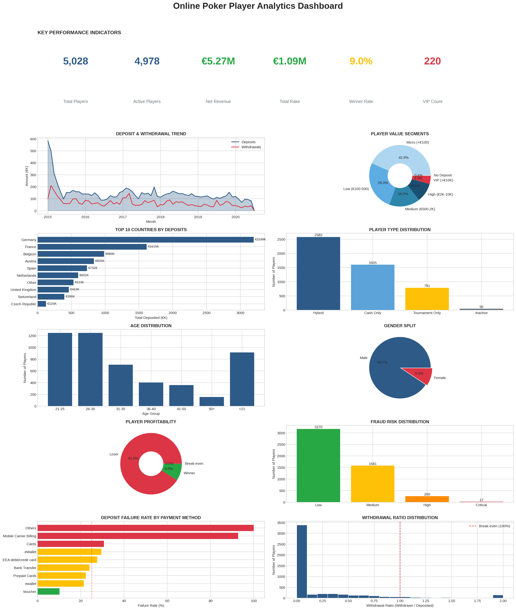
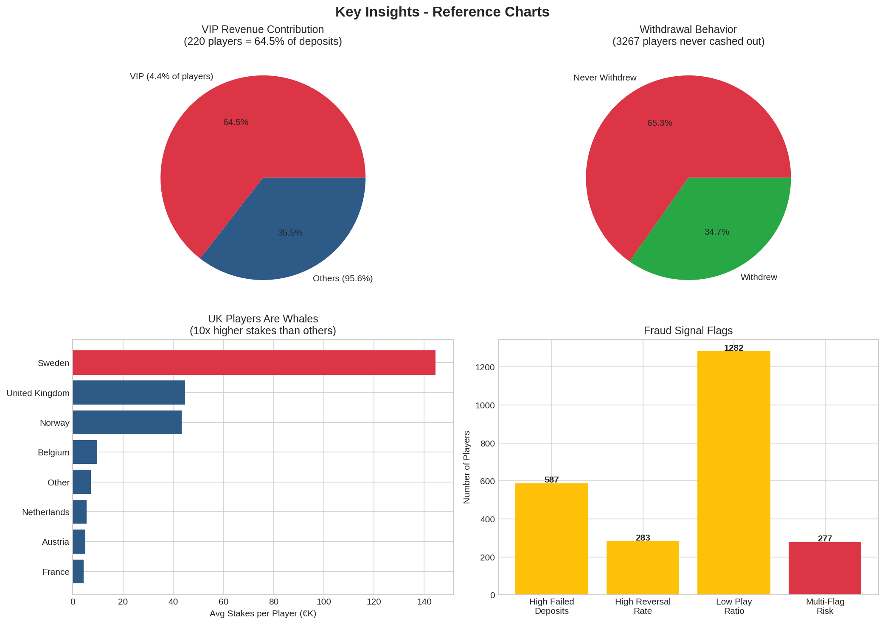
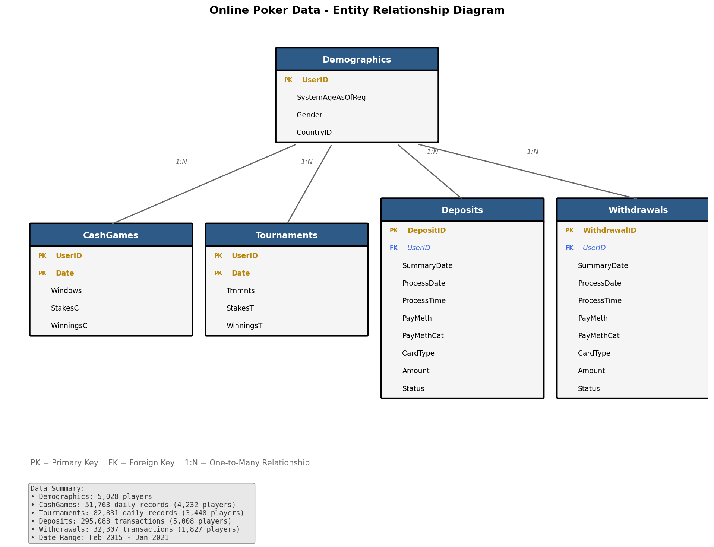

# Online Poker Player Analytics

**End-to-end data analysis of 5,028 online poker players across 467K+ transactions**

Fraud detection | Player profitability | Behavioral segmentation | Financial patterns



---

## Project Overview

Analyzed 6 years (2015-2021) of real online poker player data to uncover behavioral patterns, identify fraud signals, and deliver actionable business insights.

**Dataset:** [The Transparency Project](https://thetransparencyproject.org/) - Harvard Medical School / Entain plc
- 5,028 players
- 51,763 cash game records
- 82,831 tournament records
- 295,088 deposit transactions
- 32,307 withdrawal transactions

---

## Key Findings

### 1. Only 9% of Players Are Profitable



- 91% of players lose money (expected in rake-based games)
- Top winner: 51,812 EUR profit over 572 days
- Top loser: 37,723 EUR lost
- House rake: 1.09M EUR total

### 2. VIPs Drive the Business

| Segment | % of Players | % of Revenue |
|---------|--------------|--------------|
| VIP (>10K EUR deposits) | 4.4% | 64.5% |
| Everyone else | 95.6% | 35.5% |

220 players generate nearly two-thirds of all deposits.

### 3. 65% Never Withdraw

- 3,267 players deposited money but never cashed out
- Potential reasons: lost it all, abandoned accounts, still playing
- Reactivation opportunity for marketing

### 4. Fraud Signals Identified

| Flag | Players Flagged |
|------|-----------------|
| >50% failed deposit rate | 587 |
| >50% withdrawal reversal rate | 283 |
| Low play ratio (<50% of deposits played) | 1,282 |
| Multi-flag high risk | 277 |

### 5. UK Players Are Whales

| Country | Avg Stakes per Player |
|---------|----------------------|
| UK | 44,770 EUR |
| Belgium | 9,699 EUR |
| Others | 2,000-5,000 EUR |

UK players bet 10x more than average.

---

## Analysis Breakdown

### Fraud Detection
- Failed deposit patterns by payment method
- Withdrawal reversal analysis
- Quick deposit-to-withdrawal flags (money laundering signals)
- Low play ratio detection
- Composite fraud risk scoring (Low/Medium/High/Critical)

### Player Profitability
- Net profit/loss per player
- Cash game vs tournament performance
- Winner/loser distribution
- Profitability by demographics

### Deposit and Withdrawal Patterns
- Payment method preferences
- Deposit frequency and amounts
- Withdrawal behavior (who cashes out?)
- Time to first withdrawal

### Player Profiling
- Age distribution (67.7% under 30)
- Gender split (90.7% male)
- Geographic distribution (Germany 28%, France 25%)
- Player type segmentation (Hybrid/Cash Only/Tournament Only)

---

## Technical Stack

| Tool | Use |
|------|-----|
| Python | Data processing, analysis |
| Pandas | Data manipulation |
| Matplotlib | Visualization |
| SQL | Query logic (translated to pandas) |

---

## Repository Structure

```
poker-player-analytics/
├── data/
│   └── processed/              # Analysis-ready datasets
├── scripts/
│   ├── fraud_analysis.py
│   ├── profitability_analysis.py
│   ├── deposit_withdrawal_analysis.py
│   └── player_profiling.py
├── outputs/
│   └── flagged_*.csv           # Fraud-flagged players
├── images/
│   ├── dashboard_preview.png
│   ├── key_insights.png
│   └── erd.png
└── README.md
```

---

## Data Model



5 source tables joined on UserID:
- Demographics (1 row per player)
- CashGames (daily aggregates)
- Tournaments (daily aggregates)
- Deposits (transaction-level)
- Withdrawals (transaction-level)

---

## Business Recommendations

| Finding | Recommendation |
|---------|----------------|
| 220 VIPs = 64.5% revenue | Dedicated VIP retention program |
| 65% never withdrew | Reactivation campaign targeting dormant accounts |
| 277 high-risk fraud accounts | Automated flagging system + manual review |
| Mobile Carrier 93% fail rate | Disable or add verification for this payment method |
| UK players high-stakes | Geo-targeted marketing for UK market |

---

## How to Run

```bash
# Clone repository
git clone https://github.com/Akshay-Tanpure/poker-player-analytics.git

# Install dependencies
pip install pandas numpy matplotlib

# Run analysis scripts
python scripts/fraud_analysis.py
python scripts/profitability_analysis.py
python scripts/deposit_withdrawal_analysis.py
python scripts/player_profiling.py
```

---

## Data Source

Dataset from [The Transparency Project](https://thetransparencyproject.org/) by Division on Addiction, Cambridge Health Alliance (Harvard Medical School), sponsored by Entain plc.

Citation:
Tom, M. A., Edson, T. C., Louderback, E. R., Nelson, S. E., Amichia, K. A., & LaPlante, D. A. (2022). Second Session at the Virtual Poker Table: A Contemporary Study of Actual Online Poker Activity. Journal of Gambling Studies. https://doi.org/10.1007/s10899-022-10147-1

---

## License

This project uses publicly available research data. Analysis and code are available under MIT License.
